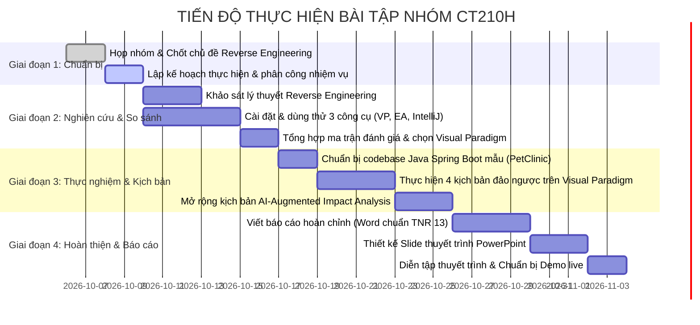

# KẾ HOẠCH THỰC HIỆN BÀI TẬP NHÓM SỐ 1
## MÔN HỌC: BẢO TRÌ PHẦN MỀM (CT210H)
**Chủ đề:** Tìm hiểu và ứng dụng công cụ Kỹ thuật đảo ngược (Reverse Engineering) trong bảo trì hệ thống Java Spring Boot  
**Công cụ lựa chọn chính:** Visual Paradigm (So sánh cùng Enterprise Architect và IntelliJ IDEA Diagram)  

---

## 1. Thông tin nhóm và Phân công vai trò

| STT | Họ và tên | MSSV | Vai trò chính | Nhiệm vụ đảm trách | Tỷ lệ đóng góp |
|:---:|:---|:---:|:---|:---|:---:|
| 1 | *[Trưởng nhóm / Bạn]* | *[MSSV 1]* | Nhóm trưởng & Kỹ thuật Backend | Quản lý tiến độ, cài đặt & thử nghiệm Visual Paradigm trên dự án Spring Boot, thiết kế kịch bản demo chính, thực hiện module AI Impact Analysis. | 100% |
| 2 | *[Thành viên 2]* | *[MSSV 2]* | Nghiên cứu công cụ & Viết báo cáo | Nghiên cứu Enterprise Architect & IntelliJ IDEA Diagram, lập bảng so sánh 3 công cụ, phụ trách mục Lý thuyết bảo trì và Reverse Engineering trong Word. | 100% |
| 3 | *[Thành viên 3]* | *[MSSV 3]* | Hỗ trợ kịch bản & Biên soạn tài liệu | Thu thập dữ liệu kịch bản demo (chụp màn hình, ghi lại các bước thao tác), định dạng file Word chuẩn Times New Roman 13, A4 và thiết kế Slide PowerPoint thuyết trình. | 100% |
| 4 | *[Thành viên 4]* *(nếu có)* | *[MSSV 4]* | Thử nghiệm & Thuyết trình | Thử nghiệm các ca kiểm thử Round-trip engineering, tổng hợp tài liệu tham khảo, đồng thuyết trình phần demo trước lớp. | 100% |

---

## 2. Kế hoạch tiến độ chi tiết (Timeline & Milestones)

Tổng thời gian thực hiện ước tính: **3 - 4 tuần** (hoặc tùy theo thời hạn nộp của giảng viên).

### Chi tiết các cột mốc:

#### Tuần 1: Khởi động, Nghiên cứu lý thuyết & Khảo sát công cụ
- **Mục tiêu:** Nắm vững cơ sở lý thuyết môn Bảo trì phần mềm về Kỹ thuật đảo ngược; cài đặt thành công 3 công cụ trên máy của các thành viên.
- **Sản phẩm bàn giao:** 
  + Bản nháp Mục 1 (Cơ sở lý thuyết Reverse Engineering trong Bảo trì phần mềm).
  + Báo cáo ghi nhận bước đầu khi dùng thử Visual Paradigm Community Edition, Enterprise Architect (Trial), và IntelliJ IDEA Diagram.

#### Tuần 2: Đánh giá so sánh 3 công cụ & Chuẩn bị môi trường thực nghiệm
- **Mục tiêu:** Xây dựng ma trận so sánh đa tiêu chí, bảo vệ lý do chọn Visual Paradigm; chuẩn bị dự án mã nguồn mở Java Spring Boot.
- **Sản phẩm bàn giao:**
  + Bảng ma trận so sánh 3 công cụ có minh chứng thực tế.
  + Kho mã nguồn Spring Boot mẫu (Spring PetClinic / Mini E-Commerce) đã build và chạy thử thành công.

#### Tuần 3: Xây dựng chuỗi kịch bản demo và Phân tích chuyên sâu
- **Mục tiêu:** Thực hiện trọn vẹn 4 kịch bản thao tác trên Visual Paradigm:
  1. Reverse Java Code sang Class Diagram (phân tầng MVC).
  2. Reverse JPA Entity sang Entity-Relationship Diagram (ERD).
  3. Round-trip Engineering: Sửa đổi trên mô hình và đồng bộ ngược về mã nguồn Java.
  4. Phân tích tác động bảo trì kết hợp AI (AI-Augmented Impact Analysis).
- **Sản phẩm bàn giao:** Bộ ảnh chụp màn hình chất lượng cao + video ghi lại quá trình demo từng bước.

#### Tuần 4: Tổng hợp Báo cáo Word, Thiết kế Slide và Diễn tập
- **Mục tiêu:** Hoàn thiện 100% hồ sơ nộp bài theo đúng quy cách của giảng viên.
- **Sản phẩm bàn giao:**
  + File Word hoàn chỉnh (Font Times New Roman 13, giãn dòng 1.15 - 1.5, lề chuẩn A4, có bìa, mục lục).
  + File Slide PowerPoint (.pptx).
  + Bản checklist câu hỏi phản biện dự kiến của giảng viên.

---

## 3. Ma trận phân công trách nhiệm (RACI Matrix)

- **R (Responsible):** Người trực tiếp thực hiện công việc.
- **A (Accountable):** Người chịu trách nhiệm phê duyệt cuối cùng (Nhóm trưởng).
- **C (Consulted):** Người được tham vấn ý kiến kỹ thuật.
- **I (Informed):** Người nhận thông báo kết quả.

| Hạng mục công việc | Nhóm trưởng | Thành viên 2 | Thành viên 3 | Thành viên 4 |
|:---|:---:|:---:|:---:|:---:|
| Khảo sát lý thuyết & viết Phần 1 | A | R | C | I |
| Cài đặt và đánh giá so sánh 3 công cụ | A | R | C | R |
| Cấu hình dự án Spring Boot & chạy Visual Paradigm | R/A | C | C | I |
| Xây dựng chuỗi kịch bản demo (Scenarios 1, 2, 3) | R/A | C | R | C |
| Xây dựng kịch bản tích hợp AI Impact Analysis | R/A | I | I | C |
| Soạn thảo và format Báo cáo file Word | A | R | R | C |
| Thiết kế Slide thuyết trình PowerPoint | C | C | R/A | C |
| Chuẩn bị môi trường & Diễn tập thuyết trình | A | R | R | R |

---

## 4. Quản lý rủi ro và Phương án xử lý (Risk Management)

| Rủi ro tiềm ẩn | Mức độ | Phương án phòng ngừa / Xử lý |
|:---|:---:|:---|
| Visual Paradigm bị lỗi bộ nhớ khi import project Java quá lớn | Trung bình | Chỉ chọn lọc import các package nghiệp vụ cốt lõi (`controller`, `service`, `model`, `repository`), loại bỏ các file cấu hình hoặc thư viện ngoài. |
| Bản quyền phần mềm (License) | Thấp | Dùng bản **Visual Paradigm Community Edition** (miễn phí trọn đời cho mục đích học tập) hoặc đăng ký Academic License. |
| Máy chiếu trên lớp không tương thích khi demo trực tiếp | Trung bình | Quay sẵn video màn hình chất lượng cao (1080p) làm backup bên cạnh phương án demo live. |
| Giảng viên hỏi sâu về sự khác biệt giữa Reverse Engineering và Decompiler | Cao | Đã chuẩn bị sẵn bảng phân biệt rõ ràng: Decompiler là dịch ngược mức máy/bytecode sang mã nguồn thô; Reverse Engineering là trích xuất mức trừu tượng cao hơn (thiết kế, kiến trúc, quan hệ lớp) để phục vụ hiểu và bảo trì. |
