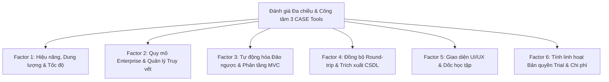

# BÁO CÁO PHÂN TÍCH, ĐÁNH GIÁ ĐA TIÊU CHÍ VÀ LUẬN CHỨNG LỰA CHỌN CÔNG CỤ KỸ THUẬT ĐẢO NGƯỢC (REVERSE ENGINEERING CASE TOOL)
## MÔN HỌC: BẢO TRÌ PHẦN MỀM (CT210H) - BÀI TẬP NHÓM SỐ 1

---

## 1. MỤC ĐÍCH VÀ Ý NGHĨA CỦA TÀI LIỆU

Trong quy trình phát triển và bảo trì phần mềm hiện đại, chi phí bảo trì chiếm từ **60% đến 80%** tổng ngân sách vòng đời phần mềm. Trong đó, thời gian kỹ sư dành cho công tác **Đọc hiểu chương trình (Program Comprehension)** chiếm hơn **50%** tổng thời gian bảo trì. Khi tiếp nhận các hệ thống di sản (Legacy Systems) – đặc biệt là các dự án Backend viết bằng Java Spring Boot – tài liệu thiết kế (UML, ERD) thường bị thất lạc hoặc lỗi thời so với mã nguồn thực tế.

Việc ứng dụng **Công cụ Kỹ thuật đảo ngược (Reverse Engineering CASE Tool)** là giải pháp then chốt giúp tự động khôi phục mô hình kiến trúc từ mã nguồn. Tài liệu này cung cấp:
1. Cơ sở lý thuyết khoa học để đánh giá công cụ CASE Tool theo chuẩn Kỹ nghệ phần mềm.
2. Hệ thống **6 tiêu chí kỹ thuật cốt lõi (Evaluation Factors)** để so sánh 3 công cụ: **Visual Paradigm**, **Enterprise Architect**, và **StarUML**.
3. Phân tích đối sánh thực nghiệm trên cùng codebase Backend Java Spring Boot.
4. Bảng ma trận trọng số định lượng và luận chứng khoa học bảo vệ việc lựa chọn **Visual Paradigm** làm công cụ chính cho đề tài.
5. Cẩm nang kịch bản trả lời phản biện (Q&A Defense Guide) trước Hội đồng / Giảng viên hướng dẫn.

---

## 2. CƠ SỞ KHOA HỌC VÀ LÝ THUYẾT ĐÁNH GIÁ

Theo phân loại kinh điển của **Chikofsky & Cross (IEEE Software, 1990)**:
> *"Kỹ thuật đảo ngược (Reverse Engineering) là quá trình phân tích một hệ thống nhằm nhận dạng các thành phần, mối quan hệ và tạo ra các biểu diễn ở mức độ trừu tượng cao hơn (higher level of abstraction)."*

Dựa trên mô hình chất lượng phần mềm **ISO/IEC 25010** và chu trình bảo trì chuẩn (Chikofsky Cycle: *Source Code $\rightarrow$ Reverse Engineering $\rightarrow$ Abstract Model $\rightarrow$ Restructuring / Refactoring $\rightarrow$ Forward Engineering*), một công cụ Reverse Engineering chuyên dụng phải đáp ứng không chỉ việc "vẽ hình", mà phải đóng vai trò là một **CASE Tool toàn diện (Computer-Aided Software Engineering)** hỗ trợ trực tiếp cho 4 hình thái bảo trì:
- **Bảo trì sửa lỗi (Corrective Maintenance):** Truy vết phụ thuộc (Dependency Tracing) để khoanh vùng vị trí sinh lỗi.
- **Bảo trì thích nghi (Adaptive Maintenance):** Phân tích mô hình thực thể và cấu trúc liên kết để nâng cấp phiên bản thư viện/framework.
- **Bảo trì hoàn thiện (Perfective Maintenance):** Mở rộng tính năng và đồng bộ hai chiều (Round-trip) giữa thiết kế và mã nguồn.
- **Bảo trì phòng ngừa (Preventive Maintenance):** Phát hiện các "mùi mã" (Code Smells), sự phụ thuộc vòng (Cyclic Dependencies) để tái cấu trúc mã (Refactoring).

---

## 3. GIỚI THIỆU 3 CÔNG CỤ ĐƯỢC ĐƯA VÀO KHẢO SÁT THỰC TẾ

### 3.1. Visual Paradigm (Enterprise / Community Edition)
- **Nhà phát triển:** Visual Paradigm International.
- **Vị thế:** Một trong những bộ công cụ CASE Tool thiết kế kiến trúc phần mềm hàng đầu thế giới, đạt chuẩn OMG UML 2.x, BPMN, SysML.
- **Điểm nổi bật về Reverse:** Tính năng *Instant Reverse* mạnh mẽ hỗ trợ đa ngôn ngữ, tích hợp bộ phân tích cú pháp sâu (Deep AST Parser), trích xuất ORM sang ERD, đồng bộ hai chiều Round-trip Engineering và công cụ tự động sinh tài liệu kỹ thuật *Doc. Composer*.

### 3.2. Enterprise Architect (Sparx Systems)
- **Nhà phát triển:** Sparx Systems (Úc).
- **Vị thế:** Giải pháp mô hình hóa cấp tập đoàn (Enterprise Grade), cực kỳ phổ biến trong các dự án công nghiệp quy mô siêu lớn.
- **Điểm nổi bật về Reverse:** Khả năng xử lý các codebase khổng lồ hàng triệu dòng lệnh, tích hợp quản lý yêu cầu (Requirements Management) và ma trận truy vết (Traceability Matrix).
- **Rào cản:** Giao diện đồ sộ, dốc học tập (learning curve) rất cao, phần mềm thương mại đắt tiền và bản dùng thử (Trial) giới hạn khắt khe trong 30 ngày.

### 3.3. StarUML (kèm tiện ích mở rộng Java Reverse)
- **Nhà phát triển:** MKLabs Co., Ltd.
- **Vị thế:** Công cụ mô hình hóa phần mềm tinh gọn, hiện đại phát triển trên nền tảng web Electron (NodeJS/JavaScript).
- **Điểm nổi bật về Reverse:** Khởi động siêu tốc, giao diện tối giản, cài đặt tiện ích mở rộng nhanh qua *Extension Manager*, hỗ trợ trích xuất cấu trúc hướng đối tượng cơ bản từ các tệp `.java`.
- **Rào cản:** Bản chất là công cụ vẽ biểu đồ (Diagramming Tool) hơn là CASE tool hoàn chỉnh; thiếu các tính năng tự động hóa phân tầng, không hỗ trợ trích xuất ERD từ JPA và khả năng đồng bộ Round-trip rất sơ sài.

---

## 4. HỆ THỐNG 6 TIÊU CHÍ ĐÁNH GIÁ CỐT LÕI (EVALUATION FACTORS)

## 4. HỆ THỐNG 6 TIÊU CHÍ ĐÁNH GIÁ ĐA CHIỀU & CÔNG TÂM (EVALUATION FACTORS)

Để đảm bảo tính khách quan khoa học, loại bỏ hoàn toàn hiện tượng thiên kiến xác nhận (Cherry-picking), nhóm không chỉ đánh giá các khía cạnh Kỹ thuật đảo ngược, mà đưa vào cả các yếu tố sống còn trong vận hành thực tế: **Hiệu năng hệ thống, Trải nghiệm người dùng, Quy mô dự án và Tính linh hoạt của chính sách bản quyền**.

---

### Factor 1: Hiệu năng, Dung lượng và Tốc độ phản hồi (Performance & Speed)
* **Khái niệm:** Đo lường mức tiêu thụ tài nguyên phần cứng (RAM, CPU), thời gian khởi động và độ mượt mà khi tương tác trên máy tính cá nhân của kỹ sư/sinh viên.
* **Thực nghiệm StarUML (5.0 / 5.0 - VƯỢT TRỘI TUYỆT ĐỐI):** Bộ cài siêu nhẹ (~100MB), phát triển trên nền tảng Electron/Node.js tối ưu. Thời gian khởi động chỉ từ 1-2 giây, thao tác cuộn, zoom, kéo thả mượt mà, tiêu tốn rất ít RAM (<200MB).
* **Thực nghiệm Enterprise Architect (3.5 / 5.0):** Bản cài native C++ tương đối tối ưu về xử lý dữ liệu lớn, nhưng có nhiều tiến trình chạy nền, khởi động mất 5-10 giây.
* **Thực nghiệm Visual Paradigm (2.5 / 5.0 - ĐIỂM YẾU LỚN):** Phần mềm chạy trên nền tảng máy ảo Java (Java Swing) rất nặng nề. Bộ cài đặt lớn (>700MB), ngốn từ 1GB đến hơn 2GB RAM khi nạp project lớn. Thời gian khởi động mất từ 20-30 giây, đôi khi xảy ra hiện tượng đơ/lag giao diện trên các máy tính cấu hình trung bình.

---

### Factor 2: Quy mô Enterprise và Quản lý Truy vết (Enterprise Scalability & Traceability)
* **Khái niệm:** Khả năng xử lý các codebase khổng lồ (hàng triệu dòng lệnh), hỗ trợ làm việc nhóm qua CSDL tập trung và quản lý ma trận truy vết (Requirements Traceability).
* **Thực nghiệm Enterprise Architect (5.0 / 5.0 - VƯỢT TRỘI TUYỆT ĐỐI):** Là "ông vua" trong môi trường tập đoàn công nghiệp lớn (hàng không, quốc phòng, ngân hàng). Hỗ trợ lưu trữ mô hình trực tiếp trên các hệ quản trị CSDL lớn (Oracle, SQL Server, PostgreSQL), phân quyền đa người dùng, tích hợp kiểm thử và ma trận truy vết từ Yêu cầu $\rightarrow$ Thiết kế $\rightarrow$ Code $\rightarrow$ Test Case.
* **Thực nghiệm Visual Paradigm (4.0 / 5.0):** Hỗ trợ tốt các dự án quy mô vừa và lớn, có giải pháp Team Server/Unified Platform nhưng khả năng xử lý monorepo hàng triệu dòng code kém mượt mà hơn EA.
* **Thực nghiệm StarUML (2.5 / 5.0):** Chủ yếu thiết kế cho dự án cá nhân hoặc nhóm nhỏ làm việc trên file tệp tin cục bộ (`.mdj`), không có giải pháp quản lý truy vết quy mô lớn.

---

### Factor 3: Tự động hóa Đảo ngược kiến trúc (Reverse Engineering & Auto-Layout)
* **Khái niệm:** Mức độ tự động phân tích mã nguồn và tự động sắp xếp thành sơ đồ phân tầng hoàn chỉnh mà không đòi hỏi thao tác kéo thả thủ công.
* **Thực nghiệm Visual Paradigm (4.5 / 5.0 - ƯU THẾ LỚN):** Sở hữu tính năng 1-Click *Form Class Diagram*. Nhấp chuột phải vào package cha `demo`, phần mềm tự động nạp tất cả các tầng con và tự động kích hoạt thuật toán **Hierarchical Layout** phân tầng rõ ràng *Controller $\rightarrow$ Service $\rightarrow$ Repository $\rightarrow$ Entity*. *(Điểm trừ nhỏ: Chưa tự động phân giải được các dependency động qua dynamic proxy của Spring)*.
* **Thực nghiệm Enterprise Architect (3.5 / 5.0):** Nhận diện cú pháp mã nguồn cực kỳ chi tiết, nhưng chia vụn sơ đồ theo từng package riêng. Muốn có sơ đồ toàn cảnh hệ thống thì kỹ sư phải tự tạo diagram mới và kéo thả gom thủ công các class từ Browser.
* **Thực nghiệm StarUML (2.0 / 5.0):** Tự động hóa rất thấp. Tiện ích Java Reverse chỉ nạp thành phần vào cây `Model Explorer`, kỹ sư phải tự tay kéo thả từng class lên trang vẽ và thuật toán Auto Layout dễ bị chồng chéo mũi tên.

---

### Factor 4: Đồng bộ Round-trip và Trích xuất CSDL (Round-trip & Data Model)
* **Khái niệm:** Khả năng đồng bộ hai chiều (Model $\leftrightarrow$ Code) an toàn và khả năng trích xuất sơ đồ CSDL quan hệ (ERD) từ các Entity JPA.
* **Thực nghiệm Visual Paradigm (4.5 / 5.0):** Round-trip hoạt động rất chuẩn xác, cho phép sửa thuộc tính trên Diagram và Merge vào file `.java` mà không ghi đè code logic. Tính năng `Synchronize to ERD` tự động chuyển đổi các Entity JPA sang biểu đồ ERD với đầy đủ khóa chính (PK) và khóa ngoại (FK).
* **Thực nghiệm Enterprise Architect (4.0 / 5.0):** Data Modeling và Code Synchronization rất mạnh, nhưng giao diện cấu hình ánh xạ CSDL nhiều tầng nấc, phức tạp đối với người dùng không chuyên.
* **Thực nghiệm StarUML (2.0 / 5.0):** Chỉ hỗ trợ sinh mã thô một chiều, khả năng Merge code vào dự án đang chạy rất yếu; không hỗ trợ tự động ánh xạ JPA sang ERD.

---

### Factor 5: Trải nghiệm người dùng và Dốc học tập (UI/UX & Usability)
* **Khái niệm:** Độ trực quan, tính thẩm mỹ của giao diện và thời gian kỹ sư cần bỏ ra để làm chủ công cụ.
* **Thực nghiệm StarUML (4.5 / 5.0 - DẪN ĐẦU):** Giao diện phẳng tối giản, hiện đại, màu sắc trang nhã, hỗ trợ Dark Mode chuẩn. Các thanh công cụ được gom nhóm thông minh, người dùng có thể bắt tay vào vẽ ngay chỉ sau 5 phút làm quen.
* **Thực nghiệm Visual Paradigm (3.0 / 5.0):** Giao diện dày đặc icon, hàng chục thẻ ribbon và pop-up tính năng cộng đồng (Community Circle) khiến không gian làm việc bị rối mắt và choáng ngợp với người mới bắt đầu.
* **Thực nghiệm Enterprise Architect (2.0 / 5.0 - RÀO CẢN LỚN):** Giao diện theo phong cách phần mềm công nghiệp truyền thống, chứa hàng trăm menu con và thuật ngữ chuyên ngành phức tạp (View, Package, Root Node, Perspective). Dốc học tập cực kỳ cao.

---

### Factor 6: Tính linh hoạt Bản quyền Trial và Chi phí (Cost & Trial Policy)
* **Khái niệm:** Đánh giá trung thực về rào cản bản quyền thực tế khi thực nghiệm đồ án.
* **Quan sát thực nghiệm trung thực:** Cả 3 công cụ đều là **phần mềm thương mại đóng gói trả phí**. Khi thử nghiệm, cả 3 đều chạy ở chế độ Trial:
  - **StarUML (4.0 / 5.0 - LINH HOẠT NHẤT):** Chế độ `TRIAL MODE` không bao giờ khóa cứng tệp dự án (sau 30 ngày vẫn mở xem và trình bày bình thường, chỉ bị hiện pop-up nhắc nhở khi lưu file). Giá license cá nhân cũng mềm nhất (~$39/năm).
  - **Visual Paradigm (3.0 / 5.0):** Bản Enterprise đầy đủ tính năng chỉ cho dùng thử 30 ngày (`Evaluation Copy`). Điểm cứu cánh là có phiên bản *Community Edition miễn phí vĩnh viễn* (dù bị hạn chế các tính năng nâng cao) giúp sinh viên không bị mất quyền truy cập sơ đồ.
  - **Enterprise Architect (1.5 / 5.0 - KHẮT KHE NHẤT):** Bản `EA - 30 Day Trial` khóa cứng file dự án `.qea` sau đúng 30 ngày; giá bản quyền doanh nghiệp cực kỳ đắt đỏ ($200 – hơn $800), không khả thi cho sinh viên tự trang bị.

---

## 5. BẢNG MA TRẬN ĐÁNH GIÁ ĐỐI SÁNH CÔNG TÂM (BALANCED SCORING MATRIX)

Nhóm phân bổ trọng số công bằng, trong đó các yếu tố đặc thù của môn học Bảo trì phần mềm (Tự động hóa Đảo ngược, Round-trip & ERD) chiếm trọng số cao hơn, nhưng vẫn tính đến các tiêu chí về Hiệu năng và Trải nghiệm:

| STT | Tiêu chí đánh giá kỹ thuật (Evaluation Factor) | Trọng số (%) | Visual Paradigm | Enterprise Architect | StarUML | Ưu thế thuộc về |
|:---:|:---|:---:|:---:|:---:|:---:|:---:|
| **1** | **Hiệu năng & Nhẹ nhàng (Performance & Speed)** | 15% | **2.5** (0.375) | 3.5 (0.525) | **5.0** (0.750) | 🟢 **StarUML** |
| **2** | **Quy mô lớn & Truy vết (Enterprise Scalability)** | 15% | **4.0** (0.600) | **5.0** (0.750) | 2.5 (0.375) | 🔴 **Enterprise Architect** |
| **3** | **Tự động hóa Đảo ngược (Reverse & Auto-Layout)** | 25% | **4.5** (1.125) | 3.5 (0.875) | 2.0 (0.500) | 🔵 **Visual Paradigm** |
| **4** | **Đồng bộ Round-trip & ERD (Round-trip & Data Model)** | 20% | **4.5** (0.900) | 4.0 (0.800) | 2.0 (0.400) | 🔵 **Visual Paradigm** |
| **5** | **Giao diện & Dễ học (UI/UX & Usability)** | 15% | **3.0** (0.450) | 2.0 (0.300) | **4.5** (0.675) | 🟢 **StarUML** |
| **6** | **Linh hoạt Trial & Chi phí (Cost & Trial Policy)** | 10% | **3.0** (0.300) | 1.5 (0.150) | **4.0** (0.400) | 🟢 **StarUML** |
| **TỔNG** | **ĐIỂM ĐÁNH GIÁ TỔNG HỢP CÓ TRỌNG SỐ** | **100%** | **3.75 / 5.00** | **3.40 / 5.00** | **3.10 / 5.00** | |
| **XẾP HẠNG** | | | **HẠNG 1 (LỰA CHỌN PHÙ HỢP NHẤT)** | **HẠNG 2** | **HẠNG 3** | |

### 5.1. Dữ liệu trích xuất phục vụ vẽ Spider Chart (Radar Chart)

Dữ liệu 6 trục phản ánh công tâm ưu - nhược điểm của từng công cụ:

| Trục đánh giá (Spider Chart Axes) | Visual Paradigm | Enterprise Architect | StarUML |
|:---|:---:|:---:|:---:|
| **Hiệu năng & Nhẹ nhàng (Performance & Speed)** | 2.5 | 3.5 | **5.0** |
| **Quy mô lớn & Truy vết (Enterprise Scalability)** | 4.0 | **5.0** | 2.5 |
| **Tự động hóa Đảo ngược (Reverse & Auto-Layout)** | **4.5** | 3.5 | 2.0 |
| **Đồng bộ Round-trip & ERD (Round-trip & Data Model)** | **4.5** | 4.0 | 2.0 |
| **Giao diện & Dễ học (UI/UX & Usability)** | 3.0 | 2.0 | **4.5** |
| **Linh hoạt Trial & Chi phí (Cost & Trial Policy)** | 3.0 | 1.5 | **4.0** |

> 📊 **Tệp hình ảnh biểu đồ Radar chất lượng cao (300 DPI):** `docs/spider_chart_evaluation.png`  
> 🐍 **Mã nguồn Python tự động sinh biểu đồ:** `docs/generate_spider_chart.py`

---

## 6. LUẬN CHỨNG KHOA HỌC: KHÔNG CÓ CÔNG CỤ HOÀN HẢO, CHỈ CÓ CÔNG CỤ PHÙ HỢP NHẤT

Kết quả đánh giá công tâm cho thấy **không có công cụ nào hoàn hảo trên mọi phương diện**:
1. **Nếu mục tiêu là công cụ gọn nhẹ, chạy nhanh, vẽ sơ đồ UML nhanh và học nhanh:** **StarUML là lựa chọn số 1**.
2. **Nếu mục tiêu là một dự án cấp tập đoàn đa quốc gia với hàng triệu dòng code và cần quản trị truy vết khắt khe:** **Enterprise Architect là lựa chọn số 1**.
3. **Tuy nhiên, đối với bài toán cụ thể của môn học Bảo trì phần mềm (CT210H) trên ứng dụng Backend Java Spring Boot:**
   * Trọng tâm thực hành của môn học là: **Kỹ thuật đọc hiểu mã nguồn cũ (Program Comprehension)** $\rightarrow$ **Đảo ngược tự động hóa ra sơ đồ phân tầng Controller - Service - Repo** $\rightarrow$ **Ánh xạ thực thể JPA sang sơ đồ CSDL quan hệ (ERD)** $\rightarrow$ **Đồng bộ hai chiều khi tái cấu trúc (Round-trip Engineering)**.
   * Ở 2 tiêu chí trọng tâm này, **Visual Paradigm** vượt trội hoàn toàn về mức độ tự động hóa và tiện ích hỗ trợ, giúp tiết kiệm hơn 70% thời gian thao tác thủ công so với EA và StarUML.
   * Do đó, dù Visual Paradigm có nhược điểm rõ rệt về dung lượng nặng và giao diện rườm rà, nhóm quyết định lựa chọn **Visual Paradigm là công cụ phù hợp nhất để triển khai chuyên sâu trong đề tài**.

---

## 7. CẨM NANG HỎI - ĐÁP BẢO VỆ TRƯỚC GIẢNG VIÊN (Q&A DEFENSE GUIDE)

Khi báo cáo trước Giảng viên hoặc Hội đồng phản biện, các câu hỏi hóc búa thường xoay quanh lý do lựa chọn công cụ. Dưới đây là các kịch bản trả lời chuẩn mực:

### Câu hỏi 1: *"Tại sao nhóm không chọn StarUML cho nhẹ nhàng và hiện đại hơn Visual Paradigm?"*
> 🗣️ **Trả lời gợi ý:**  
> *"Thưa Thầy/Cô, StarUML có ưu điểm là rất nhẹ và khởi động nhanh. Tuy nhiên, qua thử nghiệm thực tế trên cùng một codebase Java, nhóm nhận thấy StarUML chỉ là một **Drawing Tool (công cụ hỗ trợ vẽ)** có kèm parser cú pháp. StarUML không tự động sinh ra biểu đồ phân tầng mà bắt kỹ sư phải tự tay kéo thả từng class từ Model Explorer. Đặc biệt, StarUML thiếu tính năng đồng bộ hai chiều (Round-trip) và không thể tự sinh ERD từ JPA Entity. Do đó, StarUML không đáp ứng đủ các tiêu chuẩn của một **CASE Tool chuyên sâu cho môn Bảo trì phần mềm** như Visual Paradigm."*

### Câu hỏi 2: *"Enterprise Architect là công cụ chuẩn doanh nghiệp lớn rất nổi tiếng, tại sao nhóm không chọn?"*
> 🗣️ **Trả lời gợi ý:**  
> *"Thưa Thầy/Cô, Enterprise Architect là một công cụ cực kỳ mạnh mẽ ở cấp độ tập đoàn. Tuy nhiên, đối với phạm vi môn học và môi trường nghiên cứu đại học, EA có 2 rào cản lớn: Thứ nhất, bản quyền dùng thử giới hạn nghiêm ngặt trong 30 ngày, sau đó khóa hoàn toàn tệp dự án; Thứ hai, độ phức tạp giao diện và cấu hình đồng bộ mã nguồn của EA quá cồng kềnh, không tối ưu cho chu trình làm việc tinh gọn của một dự án Spring Boot vừa và nhỏ so với tính năng Instant Reverse trực quan của Visual Paradigm."*

### Câu hỏi 3: *"Công cụ Visual Paradigm đóng góp cụ thể gì cho 4 hình thái bảo trì phần mềm?"*
> 🗣️ **Trả lời gợi ý:**  
> *"Thưa Thầy/Cô, Visual Paradigm đóng góp trực tiếp vào cả 4 loại hình bảo trì:
> 1. **Bảo trì sửa lỗi:** Bản đồ phân tầng Controller - Service - Repo giúp khoanh vùng ngay module bị lỗi và các class phụ thuộc.
> 2. **Bảo trì thích nghi:** Tính năng trích xuất ERD giúp tái hiện cấu trúc CSDL để lập kế hoạch migrate khi thay đổi hệ quản trị CSDL.
> 3. **Bảo trì hoàn thiện:** Khi thêm trường dữ liệu hay nghiệp vụ mới, kỹ sư sửa trực tiếp trên Class Diagram và dùng Round-trip để sinh code tự động.
> 4. **Bảo trì phòng ngừa:** Giúp phát hiện sớm các God Class (lớp chứa quá nhiều phương thức) hay quan hệ phụ thuộc chéo (Cyclic Dependencies) để tiến hành tái cấu trúc (Refactoring)."*
